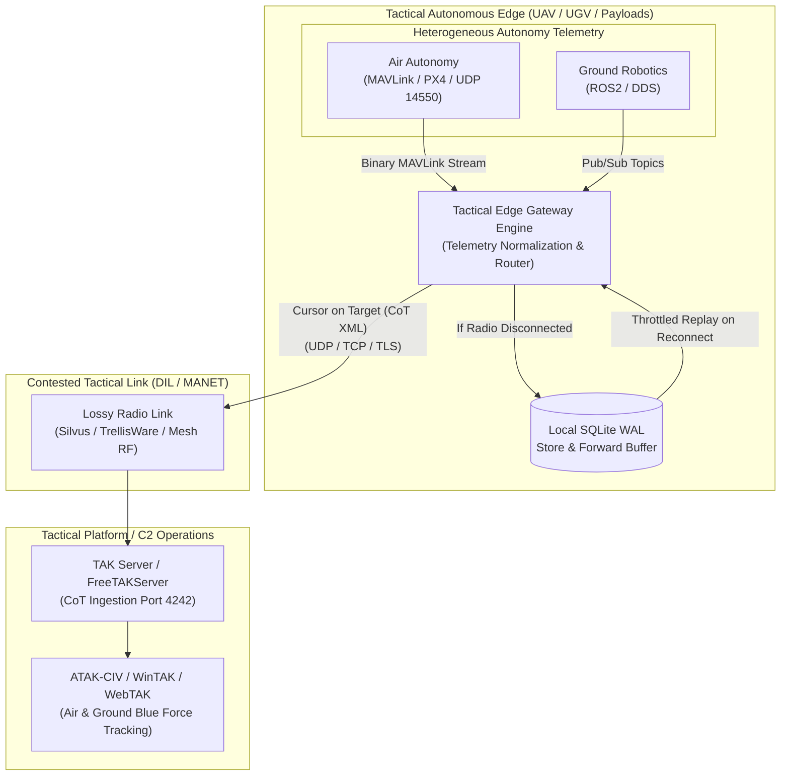

# Tactical Edge Gateway (`tactical-edge-gateway`)

[](docs/IMPLEMENTATION_PLAN.md)
[](LICENSE)
[](pyproject.toml)
[](packages/zarf/zarf.yaml)
[](docs/adr/0007-continuous-compliance-and-oscal-assessment-lula.md)
[](scripts/generate-deterministic-keys.py)


An air-gapped, resilient tactical telemetry gateway bridging heterogeneous autonomy and unmanned systems data streams (**MAVLink** and **ROS2 / DDS**) to military Command and Control (C2) situational awareness tools (**Cursor on Target / TAK Server**) over contested, disconnected (DIL) tactical radio links.

---

## Architecture Overview



---

## Key Capabilities

1. **Multi-Protocol Autonomy Ingestion:**
   * **MAVLink (UAS/Drones):** Ingests binary MAVLink streams (`HEARTBEAT`, `GLOBAL_POSITION_INT`, `ATTITUDE`, `SYS_STATUS`) over UDP port 14550 via `pymavlink`.
   * **ROS2 / DDS (UGV/Robotics):** Decoupled subscriber adapters for ROS2 `sensor_msgs/NavSatFix` and `nav_msgs/Odometry`.
   * **Synthetic Telemetry (Edge Simulator):** Generates deterministic flight and ground waypoint navigation tracks for offline headless validation and CI.
2. **Cursor on Target (CoT) & MIL-STD Symbology:** Maps multi-domain autonomy telemetry into compliant MITRE Cursor on Target (CoT) XML events, distinguishing airborne drones (`a-f-A-M-F`) from ground vehicles (`a-f-G-E-V-U`).
3. **DIL (Disconnected, Intermittent, Limited) Resilience:** Implements an embedded store-and-forward SQLite buffer that queues telemetry during radio outages and bursts historical breadcrumbs at a throttled rate upon link recovery.
4. **Declarative Air-Gap Packaging (Zarf):** Bundles all gateway layers, configuration manifests, and server containers into an offline Defense Unicorns **Zarf package** for zero-internet tactical deployments.
5. **Continuous Compliance as Code (Lula):** Employs Defense Unicorns **Lula** with machine-readable OSCAL component definitions, mapping live system configuration to NIST SP 800-53 controls (SC-8, AC-3, AC-6, SI-4) for cATO readiness.
6. **Deterministic Cryptographic Identities:** Generates reproducible Ed25519 host keypairs from an HKDF seed, eliminating the dangerous `StrictHostKeyChecking=no` anti-pattern in ephemeral testbeds.

---

## Engineering Tenets & Architectural Hygiene

This codebase emphasizes technical debt vigilance and architectural rigor over unchecked feature accretion:
* **Strategic Debt Remediation:** Following rapid multi-protocol expansion in Milestones 1–3, an intentional architectural review was conducted prior to containerization (Milestone 4). We scheduled a measured, 5-stage refactor ([Milestone 3.5](docs/milestones/milestone-3.5-core-refactoring-and-modularization.md)) to consolidate concurrency primitives into [`EvictingQueue`](docs/adr/0008-unified-queue-backpressure-and-eviction-primitives.md), unify service lifecycles via [`AsyncService`](docs/adr/0009-async-service-lifecycle-and-context-management.md), and decouple engine initialization through typed [`GatewayConfig`](docs/adr/0010-decoupled-configuration-and-engine-factory.md) models.
* **Zero-Regression Invariant:** Every atomic refactoring stage is verified through dedicated Pull Requests maintaining **100% test coverage** across all modules, passing all pre-commit hooks, and introducing zero functional regressions.
* **Documented Decision Rationale:** Every key design decision, inflection point, and trade-off is recorded as an Architecture Decision Record (ADR) capturing the *why*, not just the *what*.

---

## Directory Structure

```text
tactical-edge-gateway/
├── compliance/
│   └── lula/                     # OSCAL component definitions (oscal-component.yaml)
├── docs/
│   ├── IMPLEMENTATION_PLAN.md    # Step-by-step engineering roadmap
│   ├── adr/                      # Architecture Decision Records (ADRs 0001-0010)
│   ├── milestones/               # Tracked milestones (1 through 5)
│   └── security/                 # Threat model & deterministic key specs
├── packages/
│   └── zarf/                     # Air-gap Zarf package definition (zarf.yaml) & K8s manifests
├── scripts/
│   ├── generate-deterministic-keys.py  # HKDF-SHA256 Ed25519 generator
│   ├── setup-ssh.sh                    # Host config & SSH onboarding
│   ├── validate-lula-compliance.sh     # Automated OSCAL compliance validator
│   └── verify-airgap-package.sh        # Air-gap package verification script
├── src/
│   └── tactical_edge_gateway/    # Core Python application modules
├── tests/
│   ├── unit/                     # Unit test suites
│   └── integration/              # End-to-end integration tests (Zarf, container, Lula)
├── lula.yaml                     # Root symlink to compliance/lula/oscal-component.yaml
├── Makefile                      # Build, test, and automation commands
├── pyproject.toml                # Project metadata and dependencies
└── README.md
```

---

## Quickstart

### 1. Environment Setup
```bash
# Clone and enter the repository
git clone https://github.com/celttechie/tactical-edge-gateway.git
cd tactical-edge-gateway

# Set up Python virtual environment and install dependencies
make dev-install
```

### 2. Generate Deterministic Host Keys
```bash
# Generate reproducible Ed25519 keys for the testbed
make keys
```

### 3. Run Linting & Test Suites
```bash
make lint
make test
```

### 4. Air-Gapped Packaging with Zarf
```bash
# Package the gateway and its dependencies into a self-contained archive
make zarf-package
```

### 5. Automated Compliance Validation with Lula
```bash
# Lint OSCAL definitions and validate NIST SP 800-53 controls
make lula-lint
make lula-validate
```

---


## Architecture Decision Records (ADRs)

| ADR | Title | Status |
| :--- | :--- | :--- |
| [0001](docs/adr/0001-record-architecture-decisions.md) | Record Architecture Decisions | Accepted |
| [0002](docs/adr/0002-pubsub-telemetry-ingestion-nt4-mavlink.md) | Multi-Protocol Autonomy Ingestion (MAVLink and ROS2/DDS) | Accepted |
| [0003](docs/adr/0003-cursor-on-target-cot-xml-translation.md) | Cursor on Target (CoT) XML Translation & Schema Validation | Accepted |
| [0004](docs/adr/0004-disconnected-store-and-forward-crdt-buffering.md) | DIL Store-and-Forward Edge Buffering | Accepted |
| [0005](docs/adr/0005-airgap-delivery-zarf-and-container-least-privilege.md) | Air-Gap Delivery via Defense Unicorns Zarf | Accepted |
| [0006](docs/adr/0006-deterministic-cryptographic-identities-and-ssh-key-management.md) | Deterministic Cryptographic Identities & SSH Key Management | Accepted |
| [0007](docs/adr/0007-continuous-compliance-and-oscal-assessment-lula.md) | Continuous Compliance & OSCAL Assessment via Defense Unicorns Lula | Accepted |
| [0008](docs/adr/0008-unified-queue-backpressure-and-eviction-primitives.md) | Unified Queue Backpressure & Eviction Primitives | Accepted |
| [0009](docs/adr/0009-async-service-lifecycle-and-context-management.md) | Asynchronous Service Lifecycle & Context Management | Accepted |
| [0010](docs/adr/0010-decoupled-configuration-and-engine-factory.md) | Decoupled Gateway Configuration & Engine Factory | Accepted |

---

## License

This project is licensed under the Apache 2.0 License.
