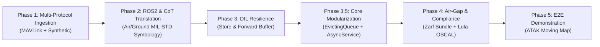

# Tactical Edge Gateway - Implementation Plan

This document details the engineering roadmap and execution plan for the **Tactical Edge Gateway**, designed to bridge heterogeneous autonomy and unmanned systems pub/sub telemetry (**MAVLink** and **ROS2/DDS**) to tactical C2 platforms (**Cursor on Target / TAK Server**) over contested DIL networks, packaged declaratively with **Zarf** and audited continuously with **Lula**.

---

## 1. Architectural Phases

### Phase 1: Multi-Protocol Ingestion Adapters & Data Modeling
* Define strongly typed telemetry dataclasses (`TelemetryFrame`, `GeodeticPosition`, `AttitudeVector`, `PlatformHealth`, `VehicleDomain`).
* Implement `MavlinkAdapter` ingesting UAV telemetry (`GLOBAL_POSITION_INT`, `ATTITUDE`, `HEARTBEAT`, `SYS_STATUS`) over UDP (port 14550) via `pymavlink`.
* Implement `SyntheticAdapter` with simulated waypoint flight/ground navigation paths.
* Add unit and live loopback network integration tests verifying schema serialization, MAVLink packet parsing, multi-vehicle state aggregation, and rate throttling.

### Phase 2: ROS2 Ingestion, CoT Transformation & TAK Network Egress
* Implement `ROS2Adapter` subscribing to `sensor_msgs/NavSatFix` and `nav_msgs/Odometry`.
* Implement `CoTTransformer` generating standard MITRE Cursor on Target (CoT) XML.
* Calculate domain-specific affiliation and symbology tags:
  * Air Autonomy (UAV): `a-f-A-M-F` (Friendly Airborne Drone).
  * Ground Autonomy (UGV): `a-f-G-E-V-U` (Friendly Ground Unmanned Vehicle).
* Build asynchronous network egress clients supporting:
  * UDP broadcast / multicast (port 4242 / 6969).
  * TCP streaming with reconnection loop.
* Validate generated XML against MITRE CoT schemas.

### Phase 3: DIL Resilience & Disconnected Store-and-Forward
* Implement SQLite-backed persistent buffer in WAL mode (`SqliteBuffer`).
* Track queue delivery states (`PENDING`, `TRANSMITTING`, `SYNCED`, `FAILED`, `EXPIRED`).
* Implement network circuit breaker with health probes (`CircuitBreaker`).
* Implement rate-limited backlog synchronization upon radio link recovery (`StoreAndForwardWorker`).
* Add end-to-end integration test validating severed links and burst recovery.

### Phase 3.5: Core Abstractions Refactoring & Codebase Modularization
* Centralize bounded FIFO drop-oldest concurrency logic into `EvictingQueue`.
* Standardize asynchronous lifecycle and context management into `AsyncService`.
* Consolidate Euler angle clamping and coordinate normalization.
* Decouple `GatewayEngine` initialization from CLI args using `GatewayConfig` Pydantic models.
* Harmonize operational metrics under unified `Stats` hierarchy.

### Phase 4: Rootless Containerization, Zarf Packaging & Lula Compliance (Completed)
* [x] Implement 12-factor configuration via `pydantic-settings`, supporting nested environment variables (`TEG_*`) and `.env` files.
* [x] Build multi-stage Dockerfile adhering to DISA Container Hardening STIG (non-root `edgeuser` UID 10001, read-only rootfs).
* [x] Create declarative `zarf.yaml` package bundling:
  * Gateway container image.
  * FreeTAKServer container image.
  * Kubernetes Restricted Pod Security Standards manifests.
* [x] Integrate Defense Unicorns **Lula** (`compliance/lula/oscal-component.yaml` / `lula.yaml`) mapping deployment to NIST SP 800-53 Rev 5 controls (SC-8, AC-3, AC-6, SI-4) and documenting FreeTAKServer deviation (`KSV-0014`).
* [x] Test offline packaging with `zarf package create`, air-gap inspection, and automated compliance validation.

### Phase 5: End-to-End Validation & ATAK Demonstration (In Progress)
* [ ] Run automated end-to-end integration scenario traversing airborne drone paths and ground rover routes simultaneously.
* [ ] Connect ATAK-CIV Android or WinTAK client to FreeTAKServer.
* [ ] Demonstrate real-time blue force tracking, link drop recovery, and historical breadcrumb synchronization.
* [ ] Record terminal and UI walkthrough for GitHub presentation.

---

## 2. Technical Stack & Standards Alignment

| Domain | Selected Technology | Standard / Reference |
| :--- | :--- | :--- |
| **Language & Runtime** | Python 3.10+ / Asyncio | PEP 621 / PyPA |
| **UAS Telemetry** | MAVLink (`pymavlink`) | MAVLink 2.0 Protocol (Micro Air Vehicle Link) |
| **Ground Autonomy** | ROS2 / DDS | ROS2 Galactic/Humble (`rclpy` / DDS pub-sub) |
| **Military C2 Schema** | Cursor on Target (CoT) XML | MITRE / MIL-STD-2525 Symbology |
| **Storage & Buffer** | SQLite (WAL Mode) | ACID Persistent Edge Store / CRDT Ordering |
| **Air-Gap Packaging** | Defense Unicorns Zarf | OCI Distribution / Zarf v0.32+ |
| **Compliance as Code** | Defense Unicorns Lula | NIST SP 800-53 Rev 5 / OSCAL Component Definitions |
| **Identity & Security** | Ed25519 / HKDF-SHA256 | RFC 8032 / RFC 5869 |
