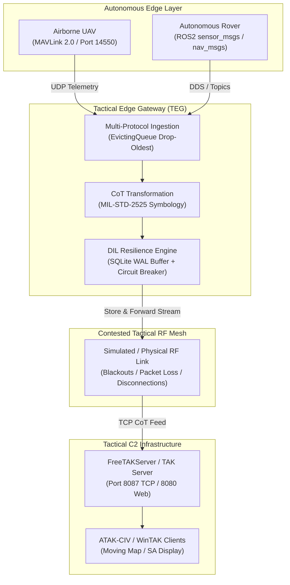

# ATAK-CIV & WinTAK Connectivity Guide

This operational guide details the procedures for configuring, connecting, and verifying **ATAK-CIV** (Android), **WinTAK** (Windows), and **WebTAK** Tactical Assault Kit clients to the **Tactical Edge Gateway** (TEG) and **FreeTAKServer** (FTS) architecture.

---

## 1. Tactical Architecture Overview



The gateway consumes heterogeneous telemetry frames from autonomous unmanned systems, transforms them into Cursor on Target (CoT) XML messages, buffers them locally during RF disruptions, and streams them to FreeTAKServer for dissemination to tactical operators.

---

## 2. Server Connection Parameters

| Parameter | Default Value | Notes |
| :--- | :--- | :--- |
| **Server Type** | FreeTAKServer / TAK Server | Standard CoT XML over TCP/UDP |
| **Edge Host / IP** | `127.0.0.1` or LAN Mesh IP | Default local loopback or edge node IP |
| **CoT Streaming Port** | `8087` (TCP) | Standard non-TLS FreeTAKServer ingestion port |
| **CoT Multicast Port** | `4242` / `6969` (UDP) | Legacy / direct broadcast streaming |
| **WebTAK UI** | `http://<host>:8080` | Web browser tactical situational awareness |
| **FTS REST API** | `http://<host>:19023` | FreeTAKServer administration & API |

---

## 3. Client Configuration Procedures

### Option A: Automatic Import via Mission Package (Recommended)

The gateway repository provides a pre-packaged ATAK Data Package ready for single-click import.

1. Locate the mission package in the repository:
   ```bash
   packages/atak/mission-package/teg-mission-package.zip
   ```
2. **On Android (ATAK-CIV)**:
   - Transfer `teg-mission-package.zip` to the Android device (via USB, QuickShare, or SD card).
   - In ATAK, tap the **Overflow Menu (three dots)** -> **Import** -> **Mission Package / Data Package**.
   - Select `teg-mission-package.zip`.
   - ATAK will automatically extract `teg-freetakserver.pref` and prompt to connect to **Tactical Edge Gateway - FreeTAKServer**.
   - Tap **Yes** to activate.
3. **On Windows (WinTAK)**:
   - Drag and drop `teg-mission-package.zip` directly into the WinTAK map window.
   - Alternatively, open **Settings** -> **Network Preferences** -> **Import Preferences** and select `teg-freetakserver.pref`.

---

### Option B: Preference File Import (`.pref`)

If deploying configuration files directly via Mobile Device Management (MDM) or TAK Server Data Synchronization:

1. Import `packages/atak/teg-freetakserver.pref`:
   ```xml
   <?xml version="1.0" encoding="utf-8" standalone="yes"?>
   <preferences>
     <preference version="1" name="cot_streams">
       <entry key="count" class="java.lang.Integer">1</entry>
       <entry key="description0" class="java.lang.String">Tactical Edge Gateway - FreeTAKServer</entry>
       <entry key="enabled0" class="java.lang.Boolean">true</entry>
       <entry key="connectString0" class="java.lang.String">127.0.0.1:8087:tcp</entry>
     </preference>
     <preference version="1" name="com.atakmap.app_preferences">
       <entry key="displayServerConnectionWidget" class="java.lang.Boolean">true</entry>
     </preference>
   </preferences>
   ```
2. In ATAK, navigate to:
   **Settings** -> **Network Preferences** -> **TAK Server** -> **Import Server Configuration** -> select `teg-freetakserver.pref`.

---

### Option C: Manual Client Connection Setup

If configuring an ATAK client manually from the user interface:

1. Open ATAK-CIV or WinTAK.
2. Navigate to **Settings** -> **Network Preferences** -> **Server Connections**.
3. Tap **Add Server** (+ icon):
   - **Name**: `TEG-Edge-FTS`
   - **Address**: `127.0.0.1` (or gateway machine IP)
   - **Port**: `8087`
   - **Protocol**: `TCP`
   - **Use SSL/TLS**: `Disabled` (for local edge simulation; enable if mutual TLS is configured)
4. Check the **Connect** toggle. The connection status indicator on the ATAK status bar will turn **Green** when connected.

---

## 4. MIL-STD Symbology & CoT Type Mapping

The gateway applies military-standard Cursor on Target types ensuring proper tactical symbology rendering on ATAK maps:

| Vehicle Type | Callsign | UID | CoT Type | MIL-STD-2525 Symbology | Map Render Details |
| :--- | :--- | :--- | :--- | :--- | :--- |
| **Airborne UAV** | `RECON-ALPHA` | `uav-alpha-01` | `a-f-A-M-F` | Friendly Airborne Military Fixed-Wing Drone | Blue circle with fixed-wing chevron; display altitude, speed, and heading vector |
| **Ground Rover (UGV)** | `GROUND-ROVER-01` | `rover-ugv-01` | `a-f-G-E-V-U` | Friendly Ground Unmanned Combat Vehicle | Blue rectangle with ground unmanned vehicle symbol; display velocity and heading |

---

## 5. Visualizing DIL (Disconnected, Intermittent, Limited) Behavior on ATAK

During operational missions, the gateway's DIL resilience subsystem operates deterministically across three phases:

```mermaid
sequenceDiagram
    autonumber
    participant Vehicle as Autonomous Drone / Rover
    participant Gateway as Tactical Edge Gateway
    participant RF as Tactical RF Link
    participant FTS as FreeTAKServer
    participant ATAK as ATAK Client Display

    Note over RF: Phase 1: Normal Link (Connected)
    Vehicle->>Gateway: Telemetry Frame (Air/Ground)
    Gateway->>Gateway: CoT Transform & Circuit Breaker (CLOSED)
    Gateway->>RF: CoT TCP Stream
    RF->>FTS: Ingest CoT
    FTS->>ATAK: Real-time update
    ATAK->>ATAK: Render Blue Vehicle Icon & Moving Heading Vector

    Note over RF: Phase 2: Radio Blackout (RF Severed / Jammed)
    Vehicle->>Gateway: Telemetry Frame
    Gateway->>RF: Transmit Probe
    RF--xGateway: Connection Refused / Timeout
    Gateway->>Gateway: Breaker Trips -> OPEN; Buffer in SQLite WAL (PENDING)
    Note over ATAK: Stale timer expires: Vehicle icon turns AMBER / YELLOW ("Stale")

    Note over RF: Phase 3: Link Restoration & Flush
    RF->>RF: RF Mesh Link Reconnected
    Gateway->>RF: Probe Probe (HALF_OPEN -> CLOSED)
    Gateway->>Gateway: Read Pending Records from SQLite WAL
    Gateway->>RF: Burst Flush Backlog Records in Chronological Order
    RF->>FTS: Ingest Backlog + Live CoT
    FTS->>ATAK: Deliver Buffered Track Points
    ATAK->>ATAK: Historic Breadcrumb Trail Backfills & Live Tracking Resumes (0% Loss)
```

### Observations on the Tactical Display:
1. **Normal State**: Icons move smoothly along their designated routes. ATAK shows active tracks with speed and heading vectors.
2. **Disruption / Blackout State**:
   - The vehicle stops moving on the ATAK screen.
   - When the CoT `stale` time window (default 30s) elapses, the ATAK icon turns **amber/yellow**, signaling link loss to tactical operators.
   - No data is lost; the gateway persistently journals every waypoint into the local SQLite database in Write-Ahead Log (WAL) mode.
3. **Re-connection & Catch-Up**:
   - Upon RF link re-establishment, the gateway's circuit breaker probes the link, closes, and streams the stored backlog in exact chronological order.
   - ATAK receives the historical points, populates the historical breadcrumb track line, and instantly snaps the live icon to the current real-time coordinates.
